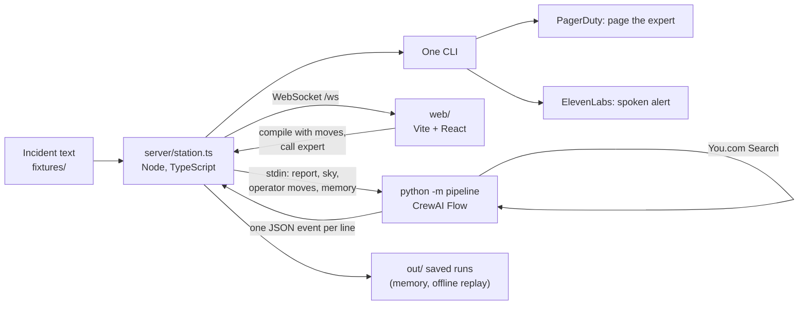

# Haunted Command Station

My entry for Track 2, The Haunted Dashboard, at Hack with YOU: Halloween Edition (AWS Builder Loft, San Francisco, October 28, 2026).

A raw incident report goes in. A working command station comes out, built live over a WebSocket.

The model reads the report, decides whether the threat is real, and builds the station this incident needs from a fixed component library: which panels, in what order, how big, under what titles, with which facts pinned on the floor plan and which next moves offered as buttons. Every countermeasure it offers cites a numbered You.com source. What the operator does then feeds the next report's station.

- **[The demo video](https://youtu.be/ZqF8nGHmYpo)**: the station at work, narrated.
- **[The live station](https://jaroslavhejlek--haunted-command-station.apify.actor)**: running on Apify, open to anyone, no sign-in. It opens on Nightfall step 1, and a cold start takes about 10 seconds.
- **[How it works](docs/how-it-works.html)**: a field manual for judges on how CrewAI, You.com, Parasail and One are used, with a guide to the code. GitHub shows it as source, so download it or open it from a clone.
- **[AGENTS.md](AGENTS.md)**: the map of the repo, the commands and the rules, for people and coding agents alike. Each main folder has its own.
- **[docs/](docs/README.md)**: the component guide, the deploy notes and the explainers.
- **[eval/](eval/README.md)**: how the station is scored against hand-written answer keys, and what that found.


## The problem

Incident logs arrive as messy text, and the severity label on them is often wrong. A console that shows every panel for every alert buries the one control that matters, and it cannot tell a real threat from a look-alike.

The station reads the text, not the label. A costume gets a calm screen, and nobody is called. A real threat gets a floor plan with a safe route, a headcount and ranked countermeasures. A single click calls the right expert: that pages a real phone, and the station shows when they acknowledge.

## Three scenarios

Pick any step from the dropdown in the incident report panel, or step through with Previous and Next.

- **Nightfall** (24 steps, 11:20 to 20:26). Vampires and werewolves arrive at the Loft on the day of this hackathon, timed to the real San Francisco sky: sunset at 18:15, full dark at 19:43, moonrise at 20:02. Five steps are harmless look-alikes, one of them tagged `CRITICAL_HAUNT`. A guest in a Dracula cape asks to be "invited in". A grid sag drops the lights. A team in wolf-ear headbands howls into a feeding-back microphone.
- **The Coffee Bar Phantom** (24 steps). A cold, erratic presence at the catering bar, among fog machines, bedsheet costumes and a subwoofer playing infrasound.
- **Zombie Rush** (24 steps). Figures drift in from Market Street, mostly outside, so the map switches to the blocks around the tower.

Only Nightfall gets the real sky, because only there does time of day drive the threat. The page also lists the official Track 2 fixture (`fixtures/haunted-dashboard.json`) and three simulated single incidents under "Single incidents", and "New incident" takes any pasted report.

## What happens on a run

1. **Intake (Parasail).** `parasail-minimax-m31-flash` turns the raw text into a structured incident under a strict `json_schema`, at temperature 0. It writes down the evidence of a threat, any ordinary explanation and whether someone acted on purpose before it rates severity, and it quotes the few phrases that drove its reading. The report panel highlights them a few seconds in: threat in red, people at risk in amber, a harmless explanation in white.
2. **Memory.** A scenario step's intake also reads what the earlier steps found. Zombie Rush's later reports only say "the figures", so this is what lets the station know what they are. A report's own checks can still clear it.
3. **Route (CrewAI Flow).** A `@router` picks a playbook: spectral, corporeal or anomalous. A named creature decides it in code (a vampire is corporeal), and the model's class is the fallback. Each playbook has its own arsenal of countermeasures.
4. **Ground (CrewAI agent and You.com).** A CrewAI Lore Researcher agent runs two You.com searches through a custom tool and writes short notes that cite the numbered sources. For a Nightfall step, the Flow also adds the live sky from wttr.in and a You.com search for the day's sunset and moonrise. If the agent skips its searches, the Flow runs them itself. Live search stands in for an indexed lore store, so every countermeasure cites a source a judge can open.
5. **Compose (Parasail, streamed).** Parasail streams the station manifest under a strict `json_schema` built from the component library, the playbook's arsenal and the number of sources. The server sends each panel to the page the moment its JSON object closes, so the station assembles while the model is still writing.
6. **Operate (One and Discord).** The operator works the station, and the next step builds on it (see below). "Call expert" pages a vampire hunter or a ghostbuster through PagerDuty with One. "Dispatch to #loft-incident" posts the escalation to the venue's Discord channel through the venue webhook, as `jarda-haunted-station · <sector> · <action> · <rationale>`, every part taken from the run. It posts once per incident, at most every two minutes, and never when the station says observe.

A run takes about 15 seconds. When the model says observe, the station shows why and recommends calling nobody.

## What the model decides, and what the code holds

The model decides:

- **The panels:** which of the 10 types, in what order, each one's title ("Who's still in the hall") and size (hero, standard or compact).
- **The facts on the map:** up to 4 markers, each a small picture of a creature, a crowd, an object or a countermeasure in its sector, plus the hot sector, the sectors to seal and the route out. The page walks the route through real doors and round sealed sectors.
- **The next moves:** 1 to 3 quick actions, such as "Seal the lounge" or "Switch to UV floods".
- **The rest:** the art, the opening sound, the recommended action (observe, contain or evacuate) and the directive.


The code holds the line:

- **Calm when harmless.** `clean_manifest` in `pipeline/library.py` keeps a harmless report calm: observe, the all-clear sound, no alarm panels.
- **Real references only.** It drops a sensor panel showing an ordinary reading, keeps only countermeasures from the playbook and sources that exist, and drops quick actions whose target does not exist.
- **Fixed geometry.** The page owns the look and the grid, so no layout the model picks can break the screen.

## The operator loop

The operator picks a countermeasure, seals sectors, marks people as out and calls experts. When they step to the next report, the page sends those moves with it:

- **The next directive builds on them.** At 20:02 it says whether the silver netting picked at 19:55 still fits.
- **The seals stay on the map.** Sectors sealed at the last step start the next one sealed.
- **The headcount follows.** The tracker counts only the people still inside.
- **An expert already called is not called again.** If the vampire hunter acknowledged the page on their phone, the next directive says what to hand over when they arrive.

## How the partners work together

| Partner | What it does here | Where |
|---|---|---|
| CrewAI | Runs the pipeline as a Flow: `@start` intake, `@router` on the incident class, one `@listen` per playbook, an `or_` join into grounding, then composition. The Lore Researcher is a CrewAI `Agent` with a `BaseTool` for You.com. Its LLM calls are recorded from CrewAI's events. | `pipeline/flow.py`, `pipeline/grounding.py`, `pipeline/proof.py` |
| You.com | The Search API (`POST https://ydc-index.io/v1/search`) grounds every countermeasure and the sky times. Each hit becomes a numbered source that the manifest cites and the page links. | `pipeline/grounding.py`, `pipeline/flow.py` |
| Parasail | Every reasoning step: intake, the Lore Researcher agent and the streamed manifest, all on `parasail-minimax-m31-flash` with `parasail-deepseek-v41-flash` as the fallback. It also writes the prompts for the art. | `pipeline/flow.py`, `pipeline/parasail.py`, `scripts/art.ts` |
| One | Every action outside the station. PagerDuty opens the expert's incident, follows it until it is acknowledged, and resolves it when the station stands down. ElevenLabs announces the call and made the 16 sound effects. | `server/one.ts`, `server/pager.ts`, `server/station.ts`, `server/speech.ts`, `scripts/sfx.ts` |

One action ids are found at run time with `one actions find`, by method and path, and never pasted in. Connection keys come from `one list`. Before its first call, the station reads the action's docs, and it never retries a page blindly.

## Architecture



- **Python only where CrewAI needs it.** `pipeline/` holds the Flow, the You.com tool and the Parasail calls. It runs as a worker that reads one incident on stdin and writes events on stdout.
- **TypeScript for everything else.** Node 24 runs `server/*.ts` directly. The page is Vite, React and TypeScript.
- **One library, three readers.** `shared/library.json` holds the 10 components, 8 sectors, 3 playbooks, 17 countermeasures and 16 sounds. The pipeline builds its `json_schema` from it, and the server and page render from it. `shared/protocol.ts` types every WebSocket message.
- **The model never writes markup.** It can only emit components from the library. All model and web text renders as text, links render only for `http` and `https`, and the prompts treat the report and search results as untrusted data.
- **It fails to a saved run.** A Parasail call with no data for 45 seconds moves to the fallback model. A pipeline run over 90 seconds is stopped, and the page replays the last saved run with a notice.

## Run it

### Offline, in one command

No keys, no Python and no network. A clean clone replays the run committed in `snapshots/` through the same WebSocket messages:

```bash
pnpm install && pnpm start --offline
```

You need Node 24.22.1 or newer and pnpm. The page opens at http://127.0.0.1:8666.

### Live

You also need Python 3.10 to 3.13 (CrewAI does not support 3.14 yet):

```bash
pnpm install
python3.13 -m venv .venv
.venv/bin/pip install -r requirements.txt
```

Put the keys in `.env`, which is gitignored:

| Variable | What it is for |
|---|---|
| `PARASAIL_API_KEY` | Parasail inference |
| `YDC_API_KEY` (or `YOU_API_KEY`) | You.com Search |
| `ONE_SECRET` | The One CLI, for PagerDuty and ElevenLabs |
| `PAGERDUTY_SERVICE_ID`, `PAGERDUTY_FROM` | The service to page, which defaults to mine, so set your own. The From email defaults to the account owner's |
| `PAGING` | Optional. `off` makes the "Call expert" buttons page nobody, for tests and the eval |
| `LOFT_WEBHOOK_URL` | Optional. The venue's #loft-incident webhook, for "Dispatch to #loft-incident". Without it, nothing is posted |
| `DISPATCH` | Optional. `off` posts nothing to #loft-incident, for tests |
| `ONE_ELEVENLABS_CONNECTION_KEY` | Optional. Only needed with more than one ElevenLabs connection in One |
| `ELEVENLABS_VOICE_ID` | Optional. The voice that announces a call |
| `HAUNT_MODEL`, `HAUNT_FALLBACK_MODEL` | Optional. Default `parasail-minimax-m31-flash` and `parasail-deepseek-v41-flash` |

Install the One CLI (`npm i -g @withone/cli`) and connect the apps with `one add pager-duty` and `one add elevenlabs`. Check every partner with `.venv/bin/python scripts/smoke_test.py`, which makes read-only calls. Then build the page and start the station:

```bash
pnpm start
```

Calling an expert pages for real, so point `PAGERDUTY_SERVICE_ID` at a service whose on-call is you.

```bash
pnpm start --incident sim-zombies-12   # start on another step or incident
pnpm start --port 8667 --no-browser    # another port, no browser
PAGING=off DISPATCH=off pnpm start     # page nobody and post nothing, for tests
pnpm check                             # type-check, unit tests, build the page
```

## Eval

`eval/run.py` runs every step of a scenario through the real pipeline and scores each station against a hand-written answer key in `fixtures/`, which the station never reads. A step earns a point each for the right action, the right call-or-not decision, the right hot sector, the expected panels, no discouraged panels and no failure: 144 points per scenario. A miss (observing a threat the key wants handled) is the worst mistake, so no change shipped that raised misses.

| Scenario | Points (of 144) | Misses | False alarms on harmless steps |
|---|---|---|---|
| Nightfall, mean of two passes | 134.9 (up from 114 for the first version) | 0 of 14 in both | 1 and 0 of 5 |
| The Coffee Bar Phantom, one pass | 114.0 | 0 of 11 | 1 of 5 |
| Zombie Rush, one pass | 108.2 | 1 of 15 | 3 of 5 |

The first version copied the feed's tier label into its severity on all 20 labelled Nightfall steps and contained almost everything. Judging the evidence first, a harmless gate in code, a sky-aware observe rule and running memory brought it here. [eval/README.md](eval/README.md) has every pass, what each change did and what is still lost.

## Proof of work

Every call to a partner is in an append-only ledger, one JSON object per line. Keys, headers and One connection keys are redacted before a line is written.

- [`proof/README.md`](proof/README.md): the summary that `pnpm proof` writes.
- [`proof/parasail.jsonl`](proof/parasail.jsonl): every Parasail call with the request, the response, token usage and latency, covering intake, layout, the CrewAI agent's calls and the art prompt writer.
- [`proof/partners.jsonl`](proof/partners.jsonl): every You.com search and every One action, with its purpose.
- [`proof/exploration/`](proof/exploration/): the morning's model tests (tool calling, streaming, strict JSON, embeddings, SVG drawing), which decided which model does what.

By 17:10 on October 28 the ledgers held 2,452 Parasail calls, about 6.1 million tokens, none of them failed, and 1,671 partner calls, 1,609 of them You.com searches. Eval runs and checks are tagged with a `context`, so they can be told from demo runs.

## Hosted on Apify

The station runs as an Apify Actor in Standby mode at **https://jaroslavhejlek--haunted-command-station.apify.actor**, built automatically from every commit to `main`, so anyone can open it without installing anything or signing in. It opens on Nightfall step 1. A cold start takes about 10 seconds. On the Actor, "Call expert" pages my phone for real, at most once a minute per expert.

If the page is opened with an API token in the URL (`?token=`), it adds the token to every URL it builds: the WebSocket, the sounds, the speech, the art and the map. The image holds no keys, which come from Apify secrets. See [`docs/deploy.md`](docs/deploy.md).

## More of the station

- **Sound.** ElevenLabs made 16 sound effects through One, committed in `web/public/sfx/` so they play offline. The model picks the opening sound the way it picks panels: a wolf howl for werewolves, the all-clear chime for a harmless report. Each call plays the expert's sting, then a voice says who is being called.
- **Art.** Parasail writes image prompts and [Z-Image Turbo](https://huggingface.co/Tongyi-MAI/Z-Image-Turbo) renders them locally through [mflux](https://github.com/mflux-community/mflux): 13 entities and look-alikes, 8 sectors, 2 hero images, 19 countermeasure icons and 16 map tokens, in `art/station/`. The model picks images by id. Run `pnpm art "a brief"` to make more.
- **Maps.** The floor view draws the Loft from `data/map/floor.json`, traced from AWS's own kiosk map, and walks safe routes through its doors (`web/src/route.ts`, with tests). The area view draws the blocks around the tower from OpenStreetMap data in `data/map/area.geojson`.
- **Sky.** The server computes the day's sky with suncalc and replaces sunset and moonrise with wttr.in's live times when the network is up. The SkyClock counts down to each event, on the scenario's clock or in real time.
- **Several viewers.** Every tab sees the same station, and each keeps its own place in the scenario.

## Project layout

```text
pipeline/        Python: the CrewAI Flow, the You.com tool, Parasail calls, the worker
server/          TypeScript: HTTP and WebSocket server, runs, memory and replays, One actions
web/             Vite + React page; web/public/sfx holds the sound effects
shared/          library.json and protocol.ts, read by all three
fixtures/        the official Track 2 incident, three simulated ones, and the three scenarios with answer keys
snapshots/       a saved run for offline mode on a fresh clone
art/station/     the images the model can pick, with their prompts and seeds
data/map/        the floor plan and the OpenStreetMap area
eval/            the scoring harness, its reports and what it found
proof/           the ledgers and the model tests
docs/            the component guide, the deploy notes and the explainers
scripts/         art.ts, sfx.ts, proof.ts and the partner smoke test
scenarios/       venue research and the lore catalog the scenarios were written from
```

## Credits

- Map data © [OpenStreetMap contributors](https://www.openstreetmap.org/copyright), under the Open Database License. See `data/map/ATTRIBUTION.md`.
- Images rendered with [Z-Image Turbo](https://huggingface.co/Tongyi-MAI/Z-Image-Turbo) through [mflux](https://github.com/mflux-community/mflux). Prompts and seeds are in `art/prompts.jsonl`.
- `pipeline/parasail.py` comes from One's Track 2 template, [withoneai/you-hackathon](https://github.com/withoneai/you-hackathon/tree/main/templates/haunted-command-station). The way the server calls One follows that template's `one_cli.py`: find the action at run time, read its docs before the first call, and never retry a write blindly.
- `fixtures/haunted-dashboard.json` is the published fixture from [youdotcom-oss/halloween-hack-2026](https://github.com/youdotcom-oss/halloween-hack-2026/tree/main/fixtures).
- Fonts: VT323 and IBM Plex Mono, both under the SIL Open Font License, bundled through Fontsource.
- Sky times from [wttr.in](https://wttr.in) and [suncalc](https://github.com/mourner/suncalc).
- Built during the hackathon with Claude Code.
