# Station components

This guide covers every panel the Haunted Command Station can show, with a screenshot of each. The model picks the panels and their order from `shared/library.json`. The page decides where each type sits on the grid (`web/src/layout.ts`).

The model also writes each panel's title and asks for its size:
- **Title:** at most 5 words that name the panel for this incident, such as "Who's still in the hall". `clean_manifest` drops a title over 6 words or 32 characters, and the panel then shows its own name. Screen readers hear the panel's own name first.
- **Size:** hero for the one panel the incident turns on, compact for a supporting reading, else standard. After the floor plan's row, a hero panel takes 8 columns and a compact one 4. A hero floor plan without a CountermeasurePicker takes the full row.

The screenshots come from live runs on 2026-10-28 at 1440x900, cropped to the panel: Nightfall step 20 for the full set, step 21 for the report panel and the floor plan, step 18 for a harmless station, Zombie Rush step 3 for the outdoor map, and `spooky-2026-9912` for the EMF gauge. "Reasoning" in the station header shows the model's reason for each panel.

`clean_manifest` (`pipeline/library.py`) never adds a panel. It only drops panels that break a rule:
- A harmless report loses CountermeasurePicker, CivilianTracker and FloorPlan.
- A quiet step, where nobody is hurt and the next sky event is hours away, loses CountermeasurePicker.
- An EMF reading at or below 5 mG loses its EMFGauge.
- A ThermalReadout at its normal temperature is dropped, unless it is the calm panel of a harmless report.
- A SystemsBoard lists the intake's systems, and goes when there are none.
- Repeated panels are dropped, and so is an EntityCard with an unknown image.

## Model components

### ThreatBanner: the incident headline

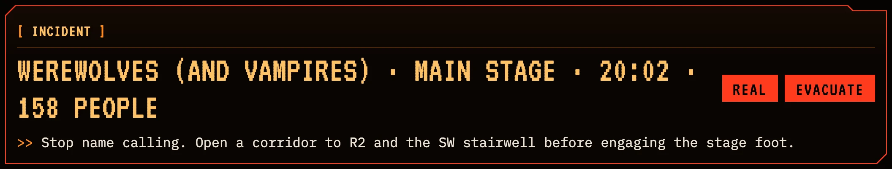
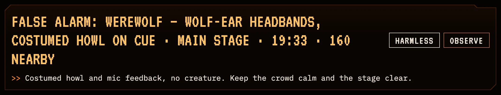

- **Shows:** what, where, when and how many people, in the largest type on the page. Two chips give the intake's verdict and the recommended action, and the line below is the model's directive.
- **When:** the prompt asks for it in every station. A harmless verdict gets a low banner that says why the report is safe.
- **Powered by:** Parasail. The headline is built from the intake's fields, and the directive comes from the streamed manifest.
- **Operator:** read only.
- **Accessibility:** the verdict and the action are written as words, so they don't rely on color.

### Quick moves: one-click actions under the directive

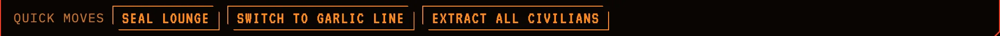

- **Shows:** 1 to 3 buttons under the ThreatBanner's directive, each an order under 5 words, such as "Seal lounge" or "Switch to garlic line". A move already in effect shows a check mark and can't be pressed again.
- **When:** the model writes them for the moves the commander most likely makes next. `clean_manifest` keeps only moves this station can run, each once:
  - seal or unseal a known sector, with a FloorPlan on the station, and never a sector the plan already seals
  - switch to a picker option other than the recommended one, which is already picked
  - get all or half of the tracked people out, with a CivilianTracker on the station
  - call a known expert
- **Clean-up:** a harmless station keeps only unseal moves. A label of 5 words or more is replaced with the code's own, such as "Seal Lounge".
- **Powered by:** Parasail writes the moves in the streamed manifest. Each one runs the same move the operator can make by hand, so the next step's station builds on it.
- **Operator:** one click seals, switches the countermeasure, marks people out or pages an expert.
- **Accessibility:** a labeled button group. A done move is marked "(done)" for screen readers and is `aria-disabled`.

### SkyClock: the sky against the clock

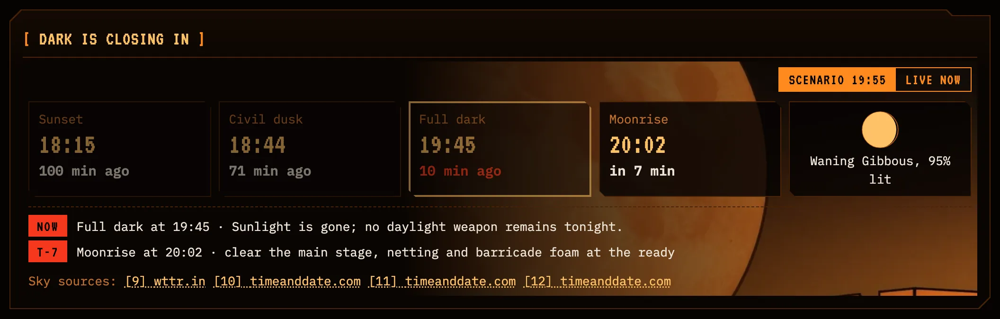

- **Shows:** sunset, civil dusk, full dark and moonrise as tiles with their local time and a countdown, plus the moon's phase and how much of it is lit. The model's focus event is outlined, and passed events are dimmed. Below them, warnings list the events from 30 minutes ahead to 10 minutes past, each with a "T-" minutes pill and what to do. The focus event is listed however far ahead it is, with the model's own warning.
- **When:** only for a run with sky data. Every step of a scenario with a sky has it, at the step's clock time. `clean_manifest` drops a warning that states times instead of an order.
- **Powered by:** the server works out the sky (`server/sky.ts`) with suncalc offline. When the network is up, wttr.in's live astronomy replaces the sunset and moonrise times. A You.com search grounds the sky facts, and Parasail picks the focus event, writes the warning and cites the sources.
- **Operator:** count down from the scenario's clock or from the live time now.
- **Accessibility:** the two clocks are pressed buttons in a group labeled "Count down from". The moon has a text label, and every time is text.

### FloorPlan: floor and around the tower

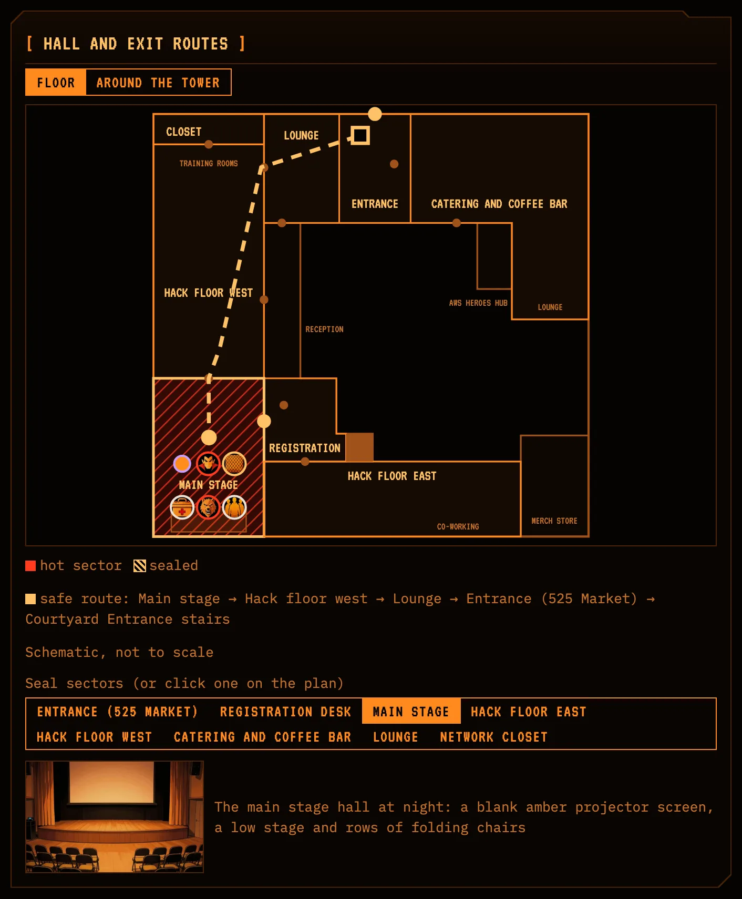
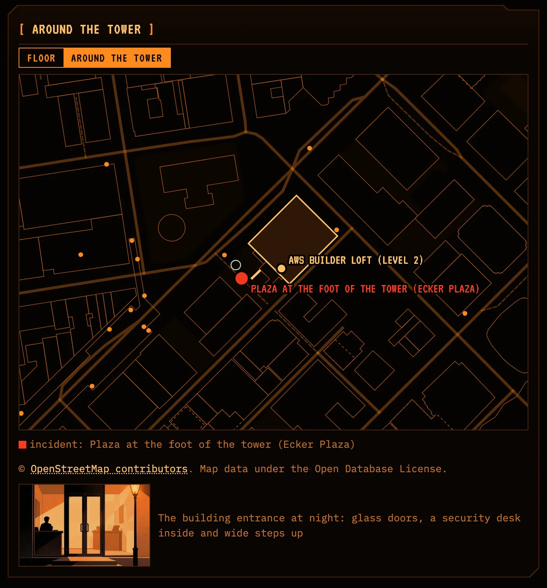

- **Shows:** two views. "Floor" is a schematic of the Loft (`data/map/floor.json`), with the hot sector in red, the sealed sectors hatched, the safe route out as a dotted line and small pictures of what is where (the markers below). "Around the tower" is the OpenStreetMap area (`data/map/area.geojson`), 150 meters around the tower, with a pin at the incident's outdoor spot, or at the venue when there is none. A scene image of the sector can sit under the plan.
- **When:** a harmless report never gets it. The model sets the area view only when the report puts the incident outside the building.
- **Route:** the model lists the sectors from where the people are to a way out. The page walks the path between them and goes round sealed sectors. When every way is sealed, the legend says which sectors block it. `clean_manifest` keeps only known sectors, and a route that stops inside the building goes on to the entrance.
- **Powered by:** Parasail places the hot sector, the seals, the route, the view, the outdoor spot and the markers. The map data is static, and OpenStreetMap is credited under the area view.
- **Operator:** switch between the views, and seal or unseal a sector by clicking it on the plan or in the "Seal sectors" list. The route redraws round the seals.
- **Accessibility:** the views and the seal list are groups of pressed buttons. The plan has a label with the hot sector, and the legend spells out the route as text.

#### Map markers

The floor view in the screenshot above has six markers in the main stage, among them "Two vampires at row 16" (a threat) and "R2 and SW stairwell jammed" (a hazard).

- **Shows:** up to 6 things from the report on the floor, each in its sector as a small round picture: a creature, people, an object or a countermeasure in place. The ring's color gives the kind: red for a threat, the text color for people, the highlight color for a countermeasure and the spook color for a hazard. Each marker's note shows only on hover or keyboard focus.
- **When:** the prompt asks for things the report gives, never the route and never an invented fact. The model picks each picture from the map tokens in `shared/library.json` (vampire, werewolf, zombie, ghost, people, injured, crate, fog, fire and more) or the countermeasure's arsenal icon. When nothing fits, the marker is a dot in a color the model picks.
- **Clean-up:** `clean_manifest` keeps markers with a known sector and kind, and cuts each label to its first 5 words that fit in 28 characters. An unknown picture becomes a dot, and an unknown color the first dot color.
- **Powered by:** Parasail places the markers. The pictures are art manifest images (`token_<id>`), made by `pnpm art` like the rest.
- **Placement:** the model only names the sector. The page finds a spot inside it where the picture overlaps the sector names, the route, the exits and earlier markers the least, nearest the sector's name among equal spots.
- **Accessibility:** each marker is focusable, and its label names the kind, the sector and the note, such as "threat in Main stage: Two vampires at row 16".

### EntityCard

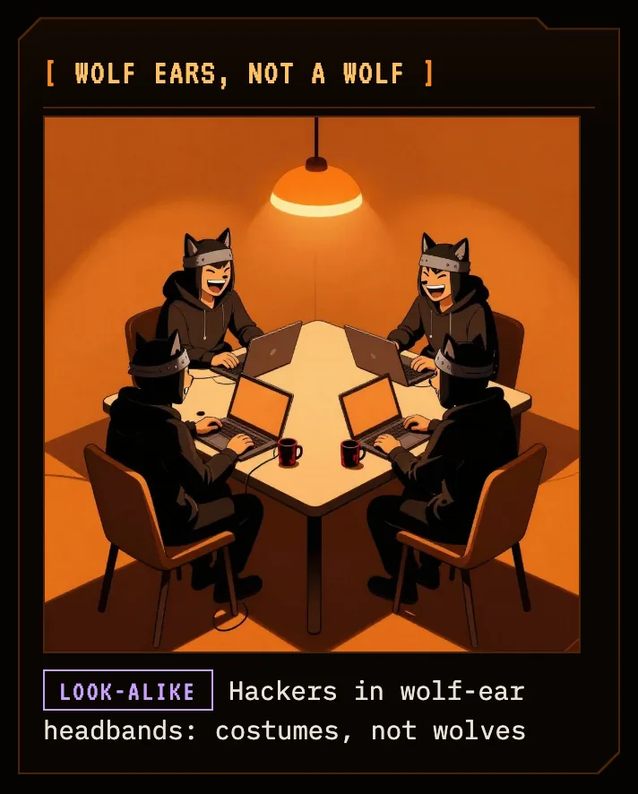

- **Shows:** a picture of the entity or of its harmless look-alike, a verdict (real, look-alike or unconfirmed) and a caption.
- **When:** only when an image in the art library matches the report. A costume or prop gets its look-alike image. For a harmless report, the prompt allows at most one of ThermalReadout, SystemsBoard or EntityCard.
- **Powered by:** the art manifest (`art/station/manifest.json`), with images made by `pnpm art`, which renders with Z-Image Turbo on a Mac. Parasail picks the image and the verdict at run time.
- **Operator:** read only.
- **Accessibility:** the image's alt text comes from the art manifest.

### CivilianTracker

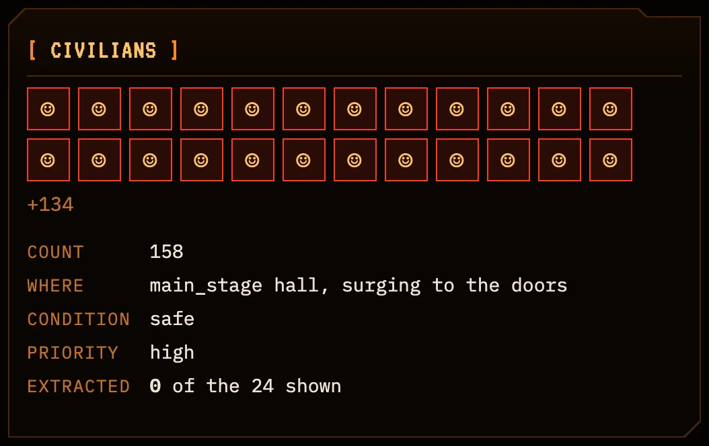

- **Shows:** up to 24 squares with the count, location, condition and extraction priority. A small group gets one square per person. A crowd is split into equal shares, such as 7 people per square for 158.
- **When:** when real people are near a real threat. A harmless report never gets it.
- **Powered by:** Parasail, from the intake's people count.
- **Operator:** click a square to mark those people extracted, and the count updates.
- **Accessibility:** each square is a toggle button labeled "Person 1" or, for a crowd, "Group 1, 7 people".

### CountermeasurePicker

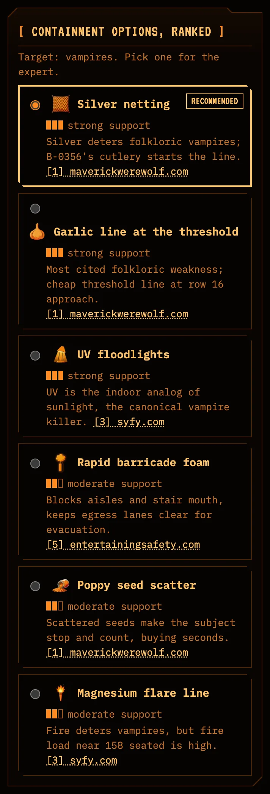

- **Shows:** options from the playbook's arsenal. The model's choice comes first, marked Recommended and selected, then the rest strongest support first. Each has a three-bar support meter with its word, a rationale and the numbered source behind it (the source title shows on hover). The target line is hidden when the model only names a class or says unknown.
- **When:** only when the action is contain or evacuate. The prompt keeps vampire countermeasures (garlic, invitations, seeds) for vampires and raising the blinds for daylight. `clean_manifest` keeps only arsenal options and valid source numbers, and drops the panel on harmless and quiet steps.
- **Powered by:** Parasail picks and explains the options, and each one cites a You.com source. The icons come from the art manifest.
- **Operator:** pick a different option than the model's.
- **Accessibility:** a radio group with a hidden legend, so arrow keys move between options.

### SystemsBoard

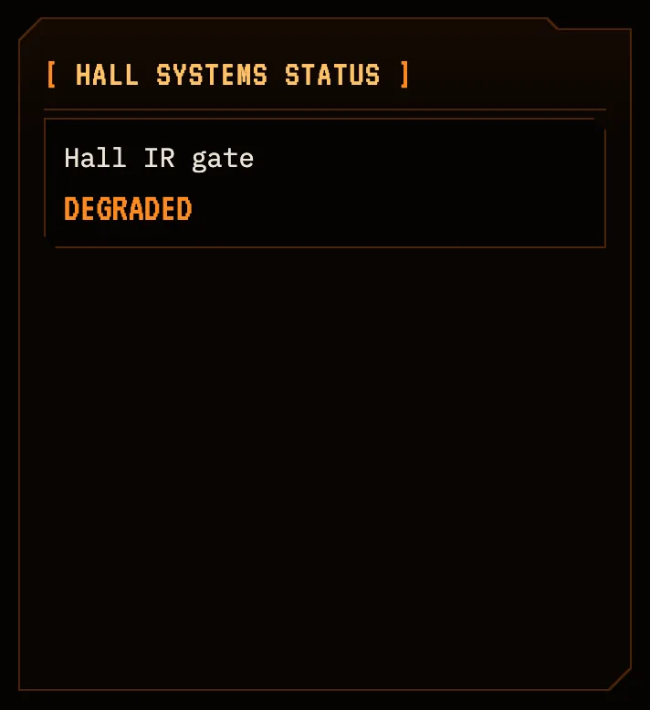

- **Shows:** the facility systems the report mentions, as tiles with a large status word: offline first in red, then degraded in amber, then online in a muted tone.
- **When:** when the report mentions systems such as the network, security, power or doors. `clean_manifest` replaces the model's list with the intake's, so the board never shows a system the report does not name, and drops an empty board.
- **Powered by:** Parasail, from the intake's list of systems.
- **Operator:** read only.
- **Accessibility:** each status is a word as well as a color.

### ThermalReadout

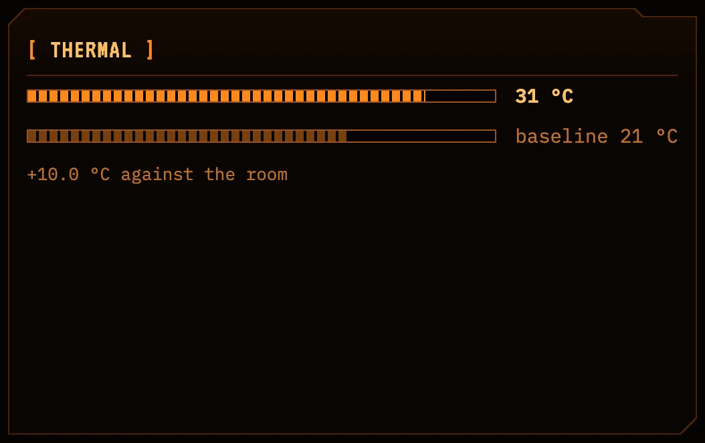

- **Shows:** the reported temperature against its normal, as two bars and the difference between them. The normal is the room temperature the report states for an air reading, 37 °C for a body or fever reading and 33 °C for skin. When the report states no room temperature, the panel shows the reading alone. In a wide row the two bars sit side by side.
- **When:** only when the report gives a temperature. The prompt tells the model never to invent sensor readings. A reading at its normal is dropped, except as the calm panel of a harmless report.
- **Powered by:** Parasail, from the intake's temperature.
- **Operator:** read only.
- **Accessibility:** both temperatures are text beside the bars.

### EMFGauge

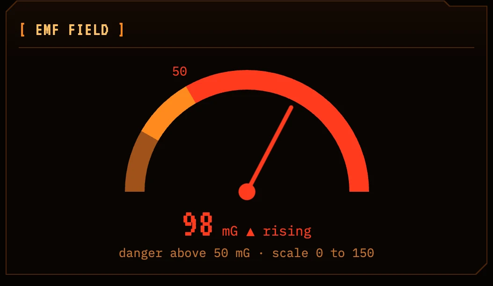

- **Shows:** a dial with the reading in milligauss, the danger threshold and the trend. The scale fits the reading, in steps of 10 mG up to 50 and of 50 above.
- **When:** only when the reading is above normal or rising. `clean_manifest` drops a gauge at 5 mG or less, and sets the status to danger when the reading is above the threshold.
- **Powered by:** Parasail, from the intake's EMF reading.
- **Operator:** read only.
- **Accessibility:** the dial has a label with the reading and the threshold, and the reading is also shown as text.

### SourceLedger

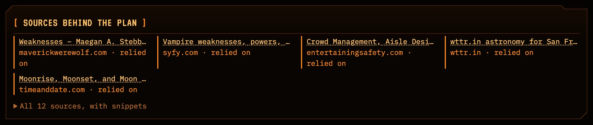

- **Shows:** five sources by title and domain, the ones the plan relies on first and marked "relied on". The rest, with their snippets, open on click. A source is relied on when a countermeasure or the sky clock cites it. `clean_manifest` sets that list, whatever the model marked.
- **When:** the prompt asks for it in every station.
- **Powered by:** You.com Search. The CrewAI Lore Researcher runs the searches, and each hit becomes a numbered source that the other panels cite.
- **Operator:** open a source in a new tab, or expand the full list.
- **Accessibility:** sources are plain links, and the expander is a standard disclosure.

## The rest of the page

These parts are always there. The model doesn't choose them.

### Top bar

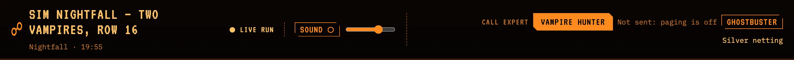

- **Shows:** the model's station title and, under it, the scenario and its clock. Then whether the station on screen is a live run, a saved run or disconnected, the sound switch with its volume, and the "Call expert" buttons.
- **Call expert:** one button per expert, vampire hunter and ghostbuster. The expert the routed playbook points to is the filled button. Each call's status sits by its button, with a Resolve link while it is open. On the right is the operator's countermeasure, or "No expert needed" on a harmless report.
- **Powered by:** the server's run state over the WebSocket, and One for the pages (see Expert calls).
- **Operator:** switch sound on and set the volume, and page an expert. A button can't be pressed before the station is built, in offline mode, or while that expert's page is open.
- **Accessibility:** the sound switch is a pressed button, the volume slider says its percent, and the experts are a labeled group.

### Incident report: the report and the step controls

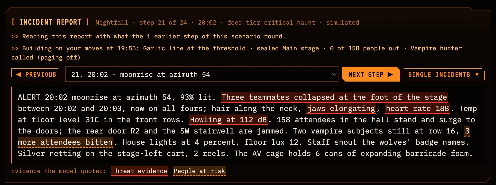

- **Shows:** the full raw report, above the station. The heading names the scenario, the step, its time, the feed tier and "simulated" for a simulated report. When this tab picked a step other than the one on screen, it adds the step on screen.
- **Evidence highlights:** the intake quotes the report's own words. Threat evidence is red with a solid underline, a harmless explanation is pale with a dotted one, and people at risk are amber with a dashed one. Hovering or focusing a highlight shows the model's reason, and a legend under the report names each kind shown. The pipeline keeps only quotes that occur in the report word for word (`clean_quotes`), and the marks show only on the report the station was built from.
- **Step controls:** "Previous", a dropdown of every scenario's steps with each step's time and opening words, and "Next step" as a solid purple button. Only a later step of the same scenario builds on the operator's moves. Going back or elsewhere starts clean.
- **Single incidents:** a menu of the standalone incidents with their feed tier and first words, plus "New incident…", which opens a box to paste any report. Compiling a pasted report needs live mode. From a single incident or a pasted report, a purple "Back to Nightfall, step 20" button (the scenario and step this tab was last on) replaces the step controls. Next step and Back share one purple in every theme, as the way through the story.
- **Memory line:** "Reading this report with what the 2 earlier steps of this scenario found." The intake reads the findings of up to 6 earlier steps, so it can follow a report that refers back to them.
- **Moves line:** "Building on your moves at 19:55:", then the countermeasure, the sealed sectors, how many people are out and each expert called, with the call's status. It shows when the station was built with the moves from the step before.
- **Powered by:** the fixtures in `fixtures/` for the text. Parasail's intake for the quotes, and the server for the moves and the memory of earlier steps.
- **Accessibility:** the controls stay focusable while a station builds and say so with `aria-disabled`, so stepping by keyboard takes one key per step. The menu closes on Escape. Highlights are focusable, and each reason is a tooltip linked to its highlight.

### Sidebar: Pipeline and Intake

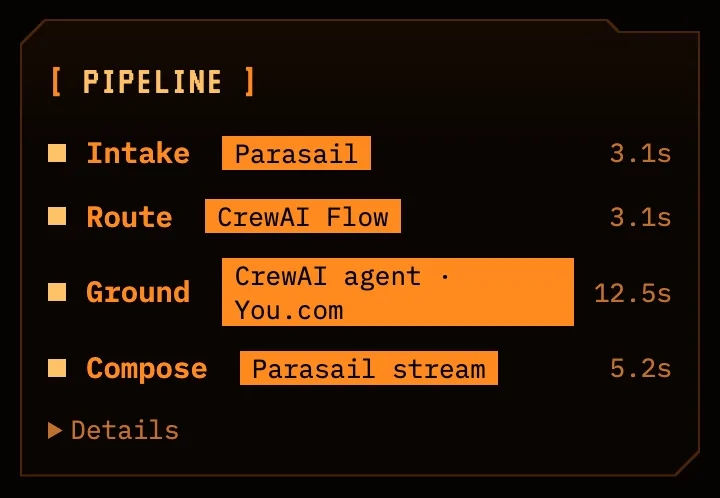
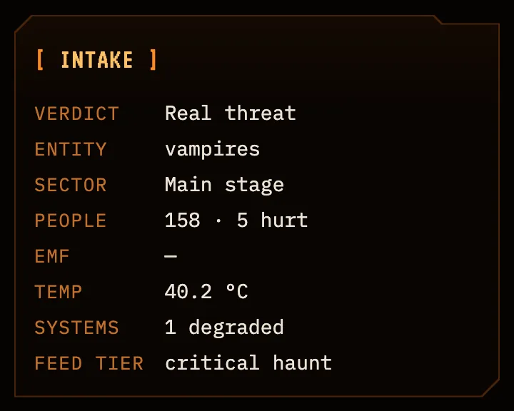

- **Pipeline:** the four phases with their partner and time: Intake (Parasail), Route (CrewAI Flow), Ground (CrewAI agent and You.com) and Compose (Parasail stream). "Details" shows each phase's result and the searches.
- **Intake:** the facts the model read from the report: verdict, entity, sector, people and how many are hurt, EMF, temperature, systems by status and feed tier.
- **Accessibility:** each panel has a heading, and the facts are a description list.

### Expert calls

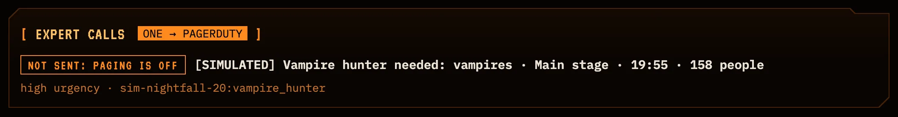

- **Shows:** every page this station has sent, under the station's panels. Each page has a status pill (Paging…, Triggered with its number, Acknowledged by first names, Resolved, Paging failed, or Not sent: paging is off), the title, the urgency and the key. A link opens the PagerDuty incident.
- **When:** after the first "Call expert" click or quick move that pages an expert. Every title starts with "[SIMULATED]", and the key is the step and the expert, so each expert has one open page per step.
- **Powered by:** One opens a real PagerDuty incident with the operator's countermeasure, and the station follows it until someone acknowledges it. With `PAGING=off` a click records a page that was not sent and calls nothing, as in the screenshot.
- **Operator:** resolve an open page. A call still standing is sent on with the next step, so that station knows the expert is coming.
- **Accessibility:** the status is a word as well as a color, and Resolve is a button.
