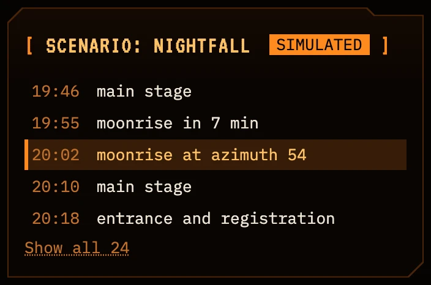
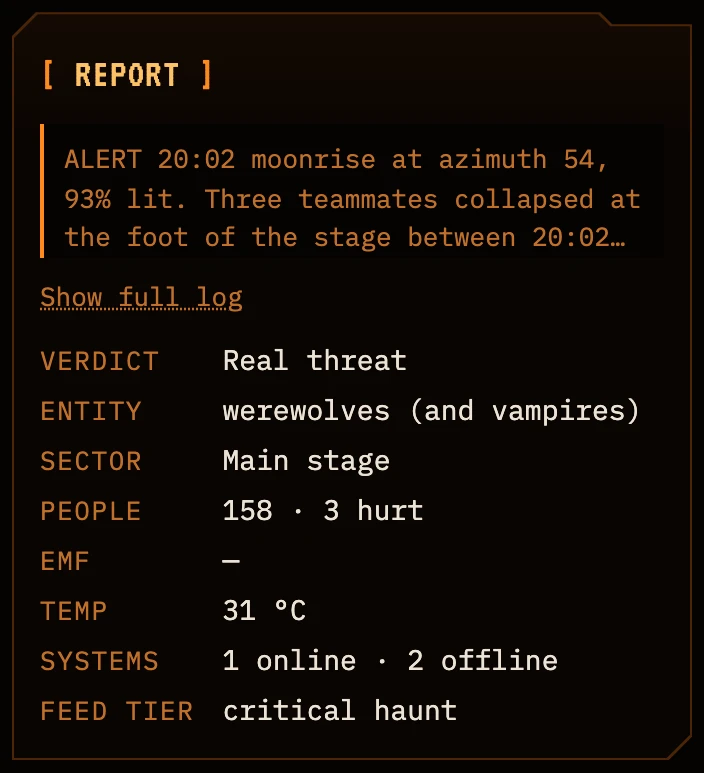

# Station components

This guide covers every panel the Haunted Command Station can show, with a screenshot of each. The model picks the panels and their order from `shared/library.json`. The page decides where each type sits on the grid (`web/src/layout.ts`).

The screenshots come from live runs on 2026-10-28 at 1440x900, cropped to the panel: Nightfall step 21 for the full set, step 18 for a harmless station, and `spooky-2026-9912` for the EMF gauge. "Show reasoning" in the station header shows the model's reason for each panel.

`clean_manifest` (`pipeline/library.py`) never adds a panel. It only drops panels that break a rule:
- A harmless report loses CountermeasurePicker, CivilianTracker and FloorPlan.
- A quiet step, where nobody is hurt and the next sky event is hours away, loses CountermeasurePicker.
- An EMF reading at or below 5 mG loses its EMFGauge.
- A ThermalReadout at its normal temperature is dropped, unless it is the calm panel of a harmless report.
- Repeated panels are dropped, and so is an EntityCard with an unknown image.

## Model components

### ThreatBanner: the incident headline

- **Shows:** what, where, when and how many people, in the largest type on the page. Two chips give the intake's verdict and the recommended action, and the line below is the model's directive.
- **When:** the prompt asks for it in every station. A harmless verdict gets a low banner that says why the report is safe.
- **Powered by:** Parasail. The headline is built from the intake's fields, and the directive comes from the streamed manifest.
- **Operator:** read only.
- **Accessibility:** the verdict and the action are written as words, so they don't rely on color.

### SkyClock

_Placeholder: the SkyClock is changing. The screenshot and notes follow once the new version lands._

### FloorPlan: floor and around the tower

_Placeholder: the FloorPlan is getting realistic routes. The screenshots of both views and the notes follow once they land._

### EntityCard

- **Shows:** a picture of the entity or of its harmless look-alike, a verdict (real, look-alike or unconfirmed) and a caption.
- **When:** only when an image in the art library matches the report. A costume or prop gets its look-alike image. For a harmless report, the prompt allows at most one of ThermalReadout, SystemsBoard or EntityCard.
- **Powered by:** the art manifest (`art/nightfall/manifest.json`), with images made by `pnpm art`, which renders with Z-Image Turbo on a Mac. Parasail picks the image and the verdict at run time.
- **Operator:** read only.
- **Accessibility:** the image's alt text comes from the art manifest.

### CivilianTracker

- **Shows:** one square per person (up to 24), with the count, location, condition and extraction priority.
- **When:** when real people are near a real threat. A harmless report never gets it.
- **Powered by:** Parasail, from the intake's people count.
- **Operator:** click a person to mark them extracted, and the count updates.
- **Accessibility:** each square is a toggle button labeled "Person 1", "Person 2" and so on.

### CountermeasurePicker

- **Shows:** options from the playbook's arsenal, strongest support first. Each has a rationale, a support meter and the numbered source behind it. The model's choice is marked Recommended and selected.
- **When:** only when the action is contain or evacuate. `clean_manifest` keeps only arsenal options and valid source numbers, and drops the panel on harmless and quiet steps.
- **Powered by:** Parasail picks and explains the options, and each one cites a You.com source. The icons come from the art manifest.
- **Operator:** pick a different option than the model's.
- **Accessibility:** a radio group with a hidden legend, so arrow keys move between options.

### SystemsBoard

- **Shows:** the facility systems the report mentions, each online, degraded or offline.
- **When:** when the report mentions systems such as the network, security, power or doors.
- **Powered by:** Parasail, from the intake's list of systems.
- **Operator:** read only.
- **Accessibility:** each status is a word as well as a color.

### ThermalReadout

- **Shows:** the reported temperature against its normal, as two bars and the difference between them. The normal is the room temperature the report states for an air reading, 37 °C for a body or fever reading and 33 °C for skin. When the report states no room temperature, the panel shows the reading alone. In a wide row the two bars sit side by side.
- **When:** only when the report gives a temperature. The prompt tells the model never to invent sensor readings. A reading at its normal is dropped, except as the calm panel of a harmless report.
- **Powered by:** Parasail, from the intake's temperature.
- **Operator:** read only.
- **Accessibility:** both temperatures are text beside the bars.

### EMFGauge

- **Shows:** a dial with the reading in milligauss, the danger threshold and the trend. The scale fits the reading, in steps of 10 mG up to 50 and of 50 above.
- **When:** only when the reading is above normal or rising. `clean_manifest` drops a gauge at 5 mG or less, and sets the status to danger when the reading is above the threshold.
- **Powered by:** Parasail, from the intake's EMF reading.
- **Operator:** read only.
- **Accessibility:** the dial has a label with the reading and the threshold, and the reading is also shown as text.

### SourceLedger

- **Shows:** five sources by title and domain, the ones the plan relies on first and marked "relied on". The rest, with their snippets, open on click. A source is relied on when a countermeasure or the sky clock cites it. `clean_manifest` sets that list, whatever the model marked.
- **When:** the prompt asks for it in every station.
- **Powered by:** You.com Search. The CrewAI Lore Researcher runs the searches, and each hit becomes a numbered source that the other panels cite.
- **Operator:** open a source in a new tab, or expand the full list.
- **Accessibility:** sources are plain links, and the expander is a standard disclosure.

## The rest of the page

These parts are always there. The model doesn't choose them.

### Top bar

_Placeholder: the top bar is being redesigned. The screenshot and notes follow once the new version lands._

### Sidebar: Scenario, Pipeline and Report

- **Scenario:** Nightfall's 24 timed reports, marked simulated. It lists five steps around the current one, with all 24 on request. Click a step to build its station.
- **Pipeline:** the four phases with their partner and time: Intake (Parasail), Route (CrewAI Flow), Ground (CrewAI agent and You.com) and Compose (Parasail stream). "Details" shows each phase's result and the searches.
- **Report:** the raw report, three lines long with "Show full log" for the rest, then the intake's facts: verdict, entity, sector, people, EMF, temperature, systems and feed tier.
- **Below them:** "Single incidents" lists the official fixture and three simulated incidents. "New incident" takes a pasted report, and it needs live mode.
- **Accessibility:** each panel has a heading, and steps and incidents are buttons.
